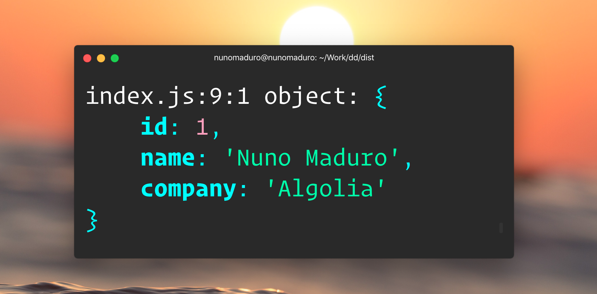

<p align="center">
  </img>
</p>
<p align="center">
    <a href="https://github.com/nunomaduro/dd/blob/master/README.md"></a>
    <a href="https://youtube.com/@nunomaduro?sub_confirmation=1"></a>
    <p align="center">
    <strong>The most popular way of debugging in PHP is now available in JavaScript</a></strong>.
  </p>
</p>

**dd** was carefully crafted to simplify the debugging of your JavaScript code directly from your terminal.
It was created and maintained by **[Nuno Maduro](https://github.com/nunomaduro)**.

## 🚀 Quick start

```sh
# First, install:
yarn add @nunomaduro/dd --dev
```

```js
// Then, use it:
import dd from '@nunomaduro/dd';

dd({ foo: 'bar' });

// Throws an error:
dd({ foo: 'bar' }).exit();
```

## 💖 Support the development
**Do you like this project? Support it by donating**

- PayPal: [Donate](https://www.paypal.com/cgi-bin/webscr?cmd=_s-xclick&hosted_button_id=66BYDWAT92N6L)
- Patreon: [Donate](https://www.patreon.com/nunomaduro)
- Github Sponsors: [Donate](https://github.com/sponsors/nunomaduro)

dd is open-sourced software licensed under the [MIT license](LICENSE.md).
